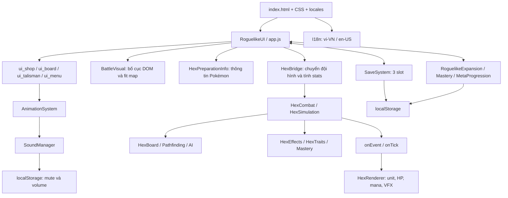

# PokéChess+ — Audit UI/UX và Skill, Phase 0

Ngày: 12/10/2026. Phạm vi: source hiện có trên nhánh `visual/battlefield-assets`, bao gồm các thay đổi visual đang có trong working tree. Đây là báo cáo kiểm tra, không phải bản triển khai các phase tiếp theo.

**Trạng thái: hoàn thành Phase 0; dừng chờ phê duyệt.** Trong lượt audit chỉ thêm tài liệu này; không sửa HTML, CSS, JS, asset, save hoặc logic game. Các thay đổi và artifact có sẵn trước audit được giữ nguyên.

## 1. Kết luận chính

- Game đã có combat Hex, auto-cast, nội tại, status, targeting, modifier, VFX và âm thanh. Cần mở rộng các implementation hiện tại, không tạo lại engine.
- Bố cục hiện tại ngược với yêu cầu mới: Bench ở dưới Battlefield, Tuyển quân bên phải. Pokémon Info đang dùng khu vực bên phải, chưa có bốn tab yêu cầu.
- Toast có sẵn nhưng thiếu nút đóng riêng, chống lặp và lịch sử. `addLog()` tìm `#moveList`, nhưng HTML hiện tại không có node này, nên chưa có Event Log hoạt động.
- Đánh thường kiểm tra range; active skill chọn mục tiêu mà chưa kiểm tra khoảng cách từ caster. Thêm range cho active skill sẽ thay đổi hành vi combat và cần quyết định riêng.
- Save hiện có ba slot, version `3.5.0`, cùng kho Mastery và progression riêng. Đổi bố cục không cần đổi schema. Chưa có lý do để migration trong Phase 1.
- Kiểm tra baseline đạt 37/37 combat tests và browser smoke test. Chưa thể coi các yêu cầu bố cục mới, toàn bộ ba profile cũ, SFX hay accessibility đã được nghiệm thu.

## 2. Kiến trúc và quản lý state

Game dùng HTML/CSS/JavaScript thuần, nạp qua `index.html`, không có `package.json`. `RoguelikeUI` giữ state phiên chơi; các module `ui_*` mở rộng prototype và render DOM trực tiếp. Vẫn tồn tại các đường combat/chess cũ bên cạnh Hex auto-battler; không được xóa chỉ vì màn hình SETUP ưu tiên Hex.

State quan trọng: `inventory`, `placedPieces`, `setupFormation`, `selectedInvId`, `selectedBoardSq`, chế độ áp dụng Talisman, `talismanInventory`, `cardChoices`, `stage`, `gold`, `maxSlots`, `phase`, `currentSaveSlot`, `runState`. Đội hình lưu liên kết bằng `invId`; inventory giữ `id`, `instanceId`, Mastery và Talisman. Runtime Hex tạo unit ID dạng `hex_${square}` và giữ nguồn `sourcePiece.invId`. Không được coi runtime ID là identity bền vững của Pokémon.

Đề xuất: tiếp tục dùng state và handler hiện tại; bố cục mới chỉ thay container, presentation và thao tác mở/đóng. Không tạo inventory thứ hai hay sao chép Pokémon sang state của panel.

## 3. Battlefield, tọa độ và scaling

`HexBoard` có 8 hàng × 7 cột, 56 ô; vùng người chơi là index 28–55. Hex pointy dùng kích thước nền 36 × 42, bước hàng 31,5 và offset hàng lẻ 18. Board, AI và pathfinding đã có implementation.

`BattleVisual.fitBoard()` đo extents của ô, rồi áp dụng một scale chung. Desktop chứa map vuông trong vùng hiển thị, có thể để khoảng trống hai bên. Chế độ compact crop phần rìa map và tính vùng cỏ khả dụng; không scale riêng từng trục. Renderer suy ra vị trí tương đối từ DOM đã transform; animation trong `app.js` đổi delta về hệ tọa độ board. Đây là các phần cần giữ khi thay layout.

Chưa có camera zoom/pan tương tác cho chiến trường. Zoom của Astral Tree là hệ khác. Phase 1 nên tối ưu kích thước container và fit hiện tại trước; nếu thêm camera sẽ phải kiểm tra lại click, drag/drop, projectile, selection và touch mapping.

## 4. Đối chiếu bố cục và thành phần tái sử dụng

| Thành phần | Hiện tại | Thay đổi đề xuất |
| --- | --- | --- |
| Header | Stats, ngôn ngữ, âm lượng, Settings đã có | Giữ handler; gom Menu/Settings, xử lý wrap và nhãn tiếng Việt |
| Utility trái | Túi, Talisman, synergy và các hệ hỗ trợ đã có | Panel thu gọn; nhóm Trang bị dùng state Talisman hiện tại |
| Battlefield | Hex và map đã tích hợp | Giữ board DOM và tọa độ; dành phần diện tích lớn nhất |
| Bench | `#inventorySlots`, tab Pokémon và nút bán trong dock dưới map | Chuyển cùng DOM sang panel phải; danh sách dọc, thông tin và trạng thái rõ |
| Tuyển quân | `#rewardCardsGrid` trong `#marketView` bên phải | Chuyển xuống dưới Battlefield; card và collapse, giữ purchase/reroll/lock handlers |
| Pokémon Info | `HexPreparationInfo` ở khu vực `#pokemonPanel` | Drawer theo lựa chọn, bốn tab; dùng stats và description hiện tại |
| Thông báo | Một toast dùng chung | Mở rộng `showToast`; thêm log có giới hạn |

`ui_shop.js` đã có mua, render Bench, deploy, recall, recall all và pricing. Giới hạn `maxSlots` áp dụng số Pokémon ra sân; mua vào inventory không tự động bị cấm khi sân đã đủ quân. Trạng thái “đầy đội” cần giải thích rằng không thể đưa thêm quân ra sân; không tự thêm điều kiện khóa mua làm thay đổi Economy.

`ui_talisman.js` đã kiểm tra mục tiêu, loại và số slot, có banner áp dụng và nút hủy. Cần làm rõ chế độ chọn Talisman rồi chọn Pokémon; thao tác xem Info/deploy/recall phải không vô tình lấy mất mục tiêu trang bị. Không tạo một hệ Equipment riêng nếu thực tế vẫn là Talisman hiện tại.

Info đã hiển thị stats, HP/shield, role, mô tả skill, traits/status và Mastery, cập nhật theo combat. Cần tách presentation thành tab nhưng giữ nguồn dữ liệu. Bench hiện còn gắn click với chọn/recall/deploy: phải thiết kế thao tác xem thông tin rõ, nhất là trên touch.

## 5. Design system, responsive và accessibility

`style.css` có token cơ bản; `css/battle_visual.css` phủ skin lên các stylesheet Hex và layout cũ. Spacing, radius, màu và z-index còn nhiều giá trị riêng và override `!important`. Asset skin dùng chung cho panel/title, tab/button, HP và selection có thể tái sử dụng; không cần thay bộ asset.

- Chuẩn hóa token có phạm vi cho layout mới trước, tránh chỉnh toàn bộ CSS cũ cùng lúc.
- Toast hiện có chữ khoảng 6px; cần tăng khả năng đọc, chiều cao dòng và vùng chạm. Chế độ thấp dưới 500px đang thu nhỏ control còn khoảng 32px.
- Font chính từ Google Fonts (`Silkscreen`, `Press Start 2P`) với fallback monospace. Chưa xác minh đủ glyph tiếng Việt và hoạt động offline; nên chọn font UI có dấu đầy đủ, giữ pixel font cho nhãn ngắn nếu phù hợp.
- Breakpoint compact hiện ở 1050px; drawer đặt top cố định 60px hoặc 46px trong khi header portrait có thể wrap. Cần dựa trên chiều cao header thực tế và safe area.
- Có một số focus state, board/Bench hỗ trợ focus và keyboard. Chưa thấy cấu trúc đầy đủ cho `aria-live`, focus trap/return của modal drawer hoặc đồng bộ `aria-expanded` ở mọi đường mở Info.
- Escape đóng drawer, nhưng cần kiểm tra thứ tự overlay và trả focus. Không tìm thấy xử lý `prefers-reduced-motion` trong các đường UI đã kiểm tra; reduced FX hiện là setting khác.
- Cần thống nhất lớp map, unit, VFX, panel, popover, toast và modal; kiểm tra overflow của tooltip và pointer events trên overlay ở từng viewport.

Việt hóa hiện có `vi-VN`/`en-US`, formatter và fallback. Các tên/mô tả trait, vật phẩm, một số tooltip, thông báo save, tutorial/Astral và floating text còn tiếng Anh. Chuyển chuỗi hiển thị sang locale key; không đổi ID dữ liệu hoặc tên species dùng cho lookup.

## 6. Toast và Event Log

`ui_menu.js::showToast()` dùng một `#gameToast`, thay nội dung cũ và tự ẩn. Click vùng toast để đóng, chưa có nút đóng riêng. Phân loại hiện chưa đủ success/info/warning/error; không có chống lặp theo sự kiện. Timer ẩn lồng nhau có nguy cơ ẩn thông báo mới khi thay nội dung đúng lúc transition cũ kết thúc. Mỗi lần gọi còn phát SFX.

Constructor `RoguelikeUI` đã chuyển `window.alert` sang `showToast`. Vì vậy các lời gọi `alert()` trong source không đồng nghĩa với dialog native khi UI đã khởi tạo; vấn đề còn lại là nội dung thiếu cấu trúc, nhiều chuỗi tiếng Anh và đường gọi cần thống nhất.

`addLog()` không tìm thấy `#moveList` trong HTML hiện tại. Nếu chỉ thêm node, implementation cũ vẫn thiếu timestamp/category và giới hạn số dòng. `HexSimulation.events` là telemetry nội bộ của trận, không phải lịch sử phiên chơi cho người dùng.

Đề xuất mở rộng API hiện tại với type, locale key/params và dedupe key; timer thuộc từng thông báo, nút đóng và `aria-live`. Event Log giữ bộ đệm giới hạn (đề xuất 200 mục) cho hệ thống, tuyển quân, trang bị, tiến hóa, combat và boss. Gom các hit/cast liên tục thành sự kiện có ý nghĩa; không log mọi tick. Log phiên không cần lưu vào schema journey.

## 7. Skill, combat và điều kiện cast

Các hệ thống đang hoạt động thực tế:

- `HexCombat` chạy 30Hz, giới hạn trận 180 giây, sudden death sau 120 giây; cooldown skill nền 3 giây. Auto-cast được kiểm tra trước hành động AI khi đủ mana.
- Đánh thường kiểm tra mục tiêu sống, khác đội và range; tăng 15 mana sau đánh. Nhận damage tăng 5 mana. Pending hit có windup, loại bỏ mục tiêu đã chết; melee thường có kiểm tra khoảng cách khi resolve.
- Active role: tank tạo shield 30% HP tối đa; fighter 1,8×ATK; assassin 2,2×ATK; mage 1,4×ATK AoE quanh mục tiêu; marksman 2×ATK. Damage skill còn qua hệ số toàn cục 0,65 và pipeline modifier hiện tại. Boss có hành vi riêng theo phase.
- `dealDamage()` tập trung type effectiveness, outgoing/incoming modifiers, giảm damage, shield, HP, boss phase, nội tại và kill. Không được áp dụng lần hai ở skill adapter.
- `HexTraits` có berserker, guardian, vampiric, arcane, swift, laststand; `HexEffects` xử lý equipment/Astral/synergy, DoT, lifesteal và các hook sát thương. Mastery có hook skill.

`HexSkillInfo` hiện mô tả theo role; effect thực thi nằm trong switch của `HexCombat`. Trường `element: 'active'` hiện mang ý nghĩa lấy hệ đánh của unit, không phải category của kỹ năng. Không được đổi cách hiểu trường này một cách ngầm định.

`castSkill()` kiểm tra sống, đủ mana, cooldown và có địch; chọn target khóa hoặc địch gần nhất nhưng không kiểm tra range caster → target. Probe VM với fighter range đánh thường 1, caster ô 0, địch ô 55 cách 10 Hex vẫn cast thành công, mana về 0 và HP địch 100 → 94. Đây là hành vi hiện tại được tái hiện, không phải thay đổi đã phê duyệt.

Không phát hiện hệ line-of-sight tổng quát trong đường Hex đã kiểm tra. Không được tự thêm LOS hay luật stun/silence mới chỉ để điền schema. Mana được trừ khi nhánh skill hợp lệ đã thực hiện; delayed hit có thể mất mục tiêu sau thời điểm cast. Tự hoàn mana trong trường hợp đó cũng sẽ thay đổi combat.

Phase 4 nên thêm metadata thích hợp (`id`, key tên/mô tả, category, targetMode, energyCost, cooldown, castTime và VFX/SFX refs), ánh xạ effect vào pipeline cũ. Range phải mô tả đúng chính sách hiện có trước; nếu muốn giới hạn active range, cần một thay đổi balance được phê duyệt và test riêng. Giữ auto-cast, thứ tự hành động và các hệ modifier hiện tại.

## 8. VFX, asset và âm thanh

`assets/visual/manifest.json` mô tả 29 PNG UI/map/combat đã cắt từ các pack, với kích thước, slice/crop, usage và limitation. Sáu ZIP nguồn, staging và source specs tồn tại; đây không phải bằng chứng có VFX sprite sheet playback. Chưa phát hiện manifest/sprite-sheet loader cho VFX trong asset runtime đã kiểm tra.

`HexRenderer` đang thực sự phát VFX bằng DOM/CSS: projectile, particle, impact, burst, skill, heal, status, death và spawn. Renderer bọc `onEvent`/`onTick`, giữ callback cũ và khôi phục khi destroy. Có giới hạn effect đang chạy và setting `pokechess_reduced_fx`; một số floating label được throttle, nhưng status/skill chưa có dedupe chung. Cần mở rộng hook này, không dựng engine animation thứ hai.

`AnimationSystem` còn phục vụ evolution/Talisman/spell và UI. Manager âm thanh có tên `SoundManager` trong `audio.js`, đã có Web Audio SFX, mute và volume. Chưa thấy hook SFX skill trực tiếp trong HexRenderer hoặc giới hạn số voice/dedupe. BGM `assets/audio/tavern.mp3` đang thiếu. Audio nghe thực tế chưa được kiểm thử; browser suite chặn/không xác nhận playback.

Một số status dùng tên tiếng Anh từ `HexTraits.CONFIG`, boss floating text dùng `PHASE`, aria-label inspection còn tiếng Anh. Phase 5 nên liên kết VFX/SFX với metadata và cùng event cast đã có, tôn trọng mute/volume, giới hạn đồng thời và reduced motion.

### Bổ sung: bộ hoạt ảnh người dùng xác nhận sau audit

Người dùng gửi bốn HTML VFX FORGE và xác nhận bộ hoạt ảnh skill. Các tệp này bổ sung nguồn tạo asset cho Phase 5; kết luận trước đó về việc chưa có sprite-sheet loader trong runtime vẫn đúng.

| Attachment | Bộ nguồn | Số effect definitions |
| --- | --- | --- |
| `97aa6e0f-3752-404c-b1d7-cd9826570b50` | MASTER B3–B5 / C–E–F: 18 cast, 18 projectile, 8 AoE, 10 signature skill, 10 status, 6 boss | 70 |
| `12390876-231f-449a-b5c4-b087e259ad87` | Batch 2: elemental impacts | 14 |
| `94b8ec83-5c19-46b7-bc25-360e14f42056` | Batch 1: basic attack và elemental impacts | 8 |
| `234e99fc-5828-48cb-a50a-5178cae12994` | Trùng byte với Batch 1 ở trên, kiểm tra SHA-256 | Không tính thêm |

Tổng cộng 92 effect definitions từ ba nguồn khác nhau. Đã kiểm tra cú pháp JavaScript của ba nguồn và số lượng definitions trong VM; không phát hiện ID trùng bên trong từng nguồn. Chưa chạy QC canvas hoặc xác minh hình ảnh/playback trong trình duyệt ở lượt bổ sung này.

Các HTML tự vẽ frame bằng Canvas, preview qua `requestAnimationFrame` và xuất PNG strip/frames cùng `combat-vfx.json`. Các đường `assets/visual/vfx/...` trong manifest là đích xuất dự kiến, chưa chứng minh PNG đã có trong game. Nhãn DRAFT trong HTML là metadata của nguồn; xác nhận của người dùng được ghi nhận ở đây, không sửa tệp attachment.

Khi tích hợp, cần xuất asset thật, xác minh QC, frame geometry và path, rồi nối vào hook renderer hiện tại. Anchor không thể áp dụng mặc định center cho mọi effect: projectile ghi đầu ở `(64,32)`, AoE có đường đất khoảng y=84 trong frame 128, các beam có hướng phát. Preview còn lặp cả effect one-shot để xem; runtime phải tuân thủ `loop` và dọn effect khi kết thúc. Tên signature skill như Thunderbolt chỉ là hình ảnh tham chiếu, không tự thêm ability hoặc thay skill role đang có.

Xác nhận này dành cho bộ hoạt ảnh; chưa coi là phê duyệt toàn bộ Phase 1 hoặc tự động triển khai các phase khác. Lượt bổ sung chỉ cập nhật tài liệu, không thay combat, save hay asset runtime.

## 9. Save, identity và settings

| Kho dữ liệu | Nội dung và lưu ý |
| --- | --- |
| `chess_plus_save_slot_1..3` | Save version 3.5.0: stage, gold, giới hạn quân, inventory, placedPieces, formation, evolution, Talisman, shop choices, runState và masteryProfile |
| `pokechess_mastery_profiles_v1` | Mastery theo slot/journey; instance identity, XP và receipts |
| `chessplus_meta_progression_v2` | Progression chung; có fallback v1, không được tự chuyển thành dữ liệu riêng từng slot |
| `chess_music_muted`, `chess_music_volume` | Âm thanh đã lưu riêng |
| `pokechess_language`, `pokechess_reduced_fx`, `chess_tutorial_seen` | Ngôn ngữ, giảm FX và tutorial |

`applySaveData()` dọn combat/mode chọn, khôi phục state và Mastery rồi dựng stage. `RoguelikeExpansion.restore()` chuẩn hóa runState; Mastery có sửa identity thiếu/trùng/không hợp lệ. Cần giữ identity hợp lệ, không gọi tái tạo khi chỉ chuyển panel. Save là snapshot hành trình/đội hình, không phải checkpoint từng tick combat.

Import JSON có thể ghi đè slot; chưa thấy backup transactional trước ghi đè. Nếu schema phải đổi ở phase sau: backup toàn bộ namespace liên quan, tạo fixture cũ, migration chạy hai lần cho cùng kết quả và kiểm tra rollback. Phase 1–3 nên tránh đổi schema; UI settings mới chỉ dùng namespace setting riêng khi cần.

Probe serialization dùng localStorage giả đã ghi cả ba slot ở stage 50, giữ inventory ID 7, Talisman và instance ID gắn run. Đây không thay thế việc load/reload ba journey thật hoặc xác minh toàn bộ Mastery/Astral ở stage cao.

## 10. File dự kiến chỉnh sửa theo phase

Các đường dẫn dưới đây là kế hoạch, chưa phải thay đổi đã thực hiện.

| Phase | File chính | Mục đích |
| --- | --- | --- |
| 1 | `index.html`, `js/battle_visual.js`, `css/battle_visual.css`, `js/ui_shop.js`, `js/autochess/hex_preparation_info.js` | Chuyển Bench phải, Tuyển quân dưới, Utility collapse và contextual Info; reuse handler/state |
| 1, khi cần | `js/ui_board.js`, `js/ui_talisman.js`, `js/autochess/hex_view.js` | Đồng bộ thao tác lựa chọn và trang bị sau đổi container |
| 2 | `style.css`, `css/battle_visual.css`, `css/hex_board.css`, `css/hex_combat.css`, `locales/vi-VN.js`, `locales/en-US.js` | Tokens, states, font, layer và nhãn |
| 3 | `js/ui_menu.js`, `index.html`, CSS UI, locales | Mở rộng toast và bounded log; module phụ chỉ nếu API hiện tại trở nên khó quản lý |
| 4 | `js/autochess/hex_skill_info.js`, `hex_combat.js`, `hex_traits.js`, `hex_effects.js`, locales | Metadata/adapter tương thích; chỉ chỉnh execution nếu có quyết định cần thiết |
| 5 | `js/autochess/hex_preparation_info.js`, `hex_renderer.js`, `css/hex_combat.css`, `js/audio.js`, manifest nếu thêm asset thật | Tab kỹ năng, cast/target feedback và SFX |
| 6 | `index.html`, CSS UI, drawer/Info handlers, locales | Touch, keyboard, aria, focus và reduced motion |
| 7 | `js/save_system.js`, `js/ui_menu.js`, `js/mastery.js`, `js/roguelike_expansion.js` chỉ khi cần | Tương thích/backup; ưu tiên không thay schema |
| 8–9 | `tests/browser-smoke.cjs`, `tests/hex_combat.test.cjs`, tài liệu audit/validation | Kiểm thử regression có ý nghĩa và báo cáo từng phase |

Không cần sửa `js/trees/steel_tree.js` chỉ để triển khai layout. Các file tree chỉ thuộc phạm vi khi có chuỗi hiển thị cần Việt hóa hoặc lỗi cụ thể được xác nhận.

## 11. Rủi ro và kế hoạch triển khai

| Rủi ro | Cách kiểm soát |
| --- | --- |
| Chuyển DOM làm mất listener/selection hoặc tọa độ | Di chuyển node hiện có, không clone; kiểm tra desktop/touch và fit lại sau collapse |
| Bench/Info tranh chấp thao tác Talisman | Một chế độ thao tác rõ ràng, banner + hủy; kiểm tra thứ tự handler |
| Skill metadata vô tình đổi balance | So sánh combat baseline; giữ damage pipeline và auto-cast, tách quyết định range |
| Full deployed team bị hiểu thành cấm mua | Giữ Economy; phân biệt giới hạn ra sân và inventory |
| Save mất instance/gear/mastery | Không đổi schema do layout; fixture 3 slot, stage cao, reload và migration idempotent nếu cần |
| VFX/SFX hoặc log nhân đôi do subscribe lại | Kiểm tra bind/destroy, dedupe, bounded effects/voices/log |
| Chữ có dấu, drawer hoặc toast che control | Kiểm tra font/offline, header wrap, z-index, safe area, focus và viewport |
| Asset runtime thiếu | Tách lỗi baseline với lỗi mới, xác định nguồn asset trước khi tuyên bố console sạch |

Sau khi được phê duyệt, bắt đầu **Phase 1** với bố cục mới và regression các thao tác hiện có. Mỗi phase báo cáo file, component tái sử dụng, UI/logic thay đổi, test và rủi ro. Không triển khai toàn bộ phase tự động từ kết quả audit.

Điểm quyết định cho Phase 4: active skill giữ chính sách tầm hiện tại hay thêm range riêng? Khuyến nghị chuẩn hóa metadata mà giữ hành vi hiện tại trước, rồi đánh giá đổi balance riêng. Điểm “đầy đội” của Tuyển quân sẽ được diễn giải theo giới hạn ra sân hiện có, không tự khóa mua.

## 12. Kiểm thử đã chạy và giới hạn nghiệm thu

| Kiểm tra | Kết quả |
| --- | --- |
| `node --test tests/hex_combat.test.cjs` | 37/37 pass, exit 0 |
| `node tests/browser-smoke.cjs` | Pass, exit 0; dùng browser profile tạm, không sửa storage người dùng |
| Probe VM: active cast cách 10 Hex | Tái hiện cast thành công ngoài range đánh thường; không sửa behavior |
| Probe VM: serialization slot 1/2/3, stage 50 | Giữ ID, instance và Talisman trong dữ liệu tổng hợp; không phải full browser load |

Browser smoke xác minh baseline: thao tác shop/Bench/Talisman/recall/formation, save cũ và hiện tại, settings/language/pause, resize hit mapping, scale đều và touch giả lập. Test hiện dùng bố cục cũ, cần cập nhật expectation khi Phase 1 được triển khai.

Có lỗi tài nguyên baseline: `/api/list-talismans`, `/api/list-pieces`, `/api/read-talisman`, `/api/read-piece`, `/assets/audio/tavern.mp3`, `/js/pieces/nidoran_m.js`. Suite chấp nhận các thiếu hụt đã biết này; không ghi nhận runtime exception mới. Vì vậy không tuyên bố “console hoàn toàn sạch”. Chưa kiểm tra Safari/iPhone thật, âm thanh nghe thực tế, font CDN offline hay full journey của ba profile ở stage cao.

Checklist nghiệm thu các phase tiếp theo phải bao gồm đủ 20 tình huống trong MASTER PROMPT: save cũ; Hex đội hình; deploy/recall; Info; Talisman còn/đầy slot và cancel mode; mua đủ/thiếu vàng và sân đầy; auto formation; start Battle; basic/active/passive; VFX/SFX không trùng; toast không che nút; log bounded; console; desktop/tablet/mobile. Các kiểm tra chưa có tính năng tương ứng như log bounded không được đánh dấu đạt trong Phase 0.

## 13. Bàn giao Phase 0

**Cập nhật sau phê duyệt:** người dùng đã yêu cầu hoàn thành tất cả phase và tiếp tục duyệt chỉnh layout theo ảnh. Các phần dưới giữ nguyên kết luận lịch sử của audit; trạng thái triển khai/kiểm thử mới ở [báo cáo bàn giao](ui-skill-delivery.md) và [audit layout mới](layout-revision.md).

- File thêm: `docs/audits/ui-skill-phase-0.md`.
- Component mới: không có; danh sách tái sử dụng và kiến trúc ở trên.
- Thay đổi UI/UX, combat, Economy, save: không có trong lượt audit.
- Bước tiếp theo: chờ người dùng phê duyệt Phase 1 theo bố cục và phạm vi báo cáo này.
